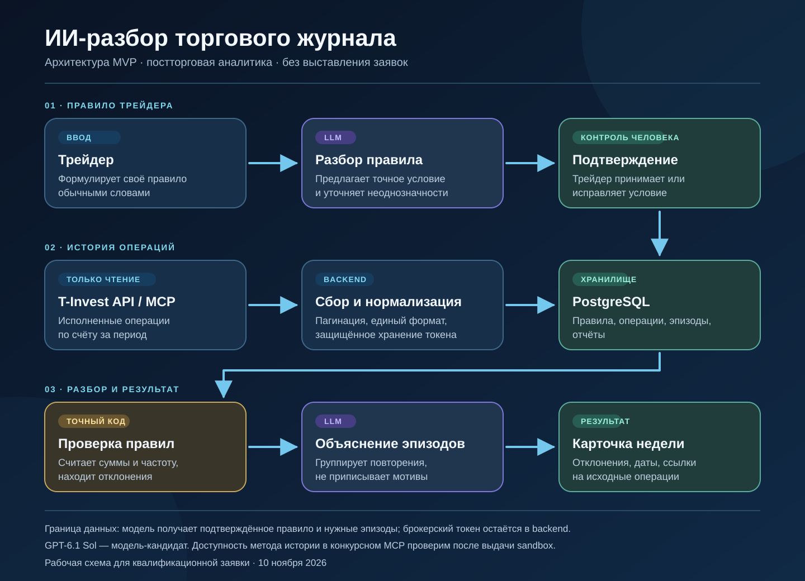

# ИИ-разбор торгового журнала — архитектура MVP

Схема предполагаемого решения для диагностического AI-задания хакатона «Инвест. Премаркет». Это проектный контур, **не работающий прототип**.

Трейдер формулирует собственное правило и подтверждает точную формулировку, предложенную LLM. Backend в режиме чтения получает исполненные операции из T-Invest API, нормализует их и сохраняет вместе с правилами в PostgreSQL. Проверяемые отклонения находит обычный код; LLM группирует эпизоды и формирует понятное объяснение. Результат — еженедельная карточка с датами и ссылками на исходные операции. Агент не выставляет заявки.

Брокерский токен остаётся на backend; модели передаются только нужные для объяснения данные. GPT-6.1 Sol — модель-кандидат. Доступность истории операций через конкурсный MCP и качество объяснений предстоит проверить после получения sandbox.

Подготовлено 10 ноября 2026 года.
